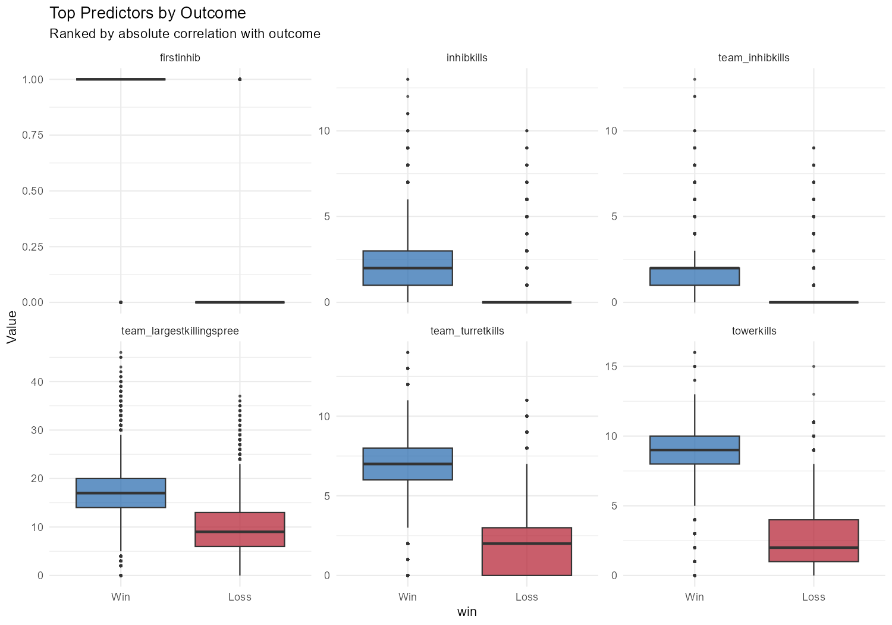
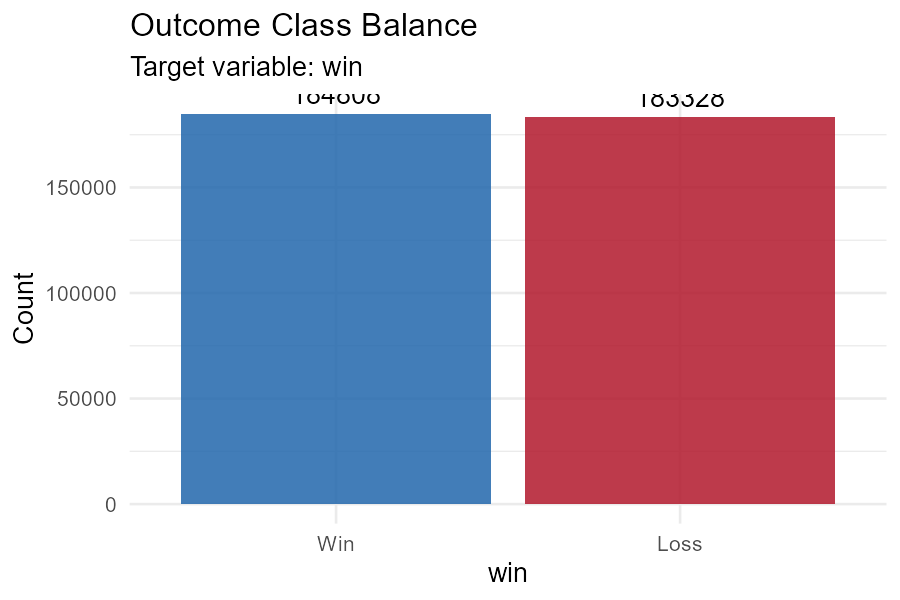
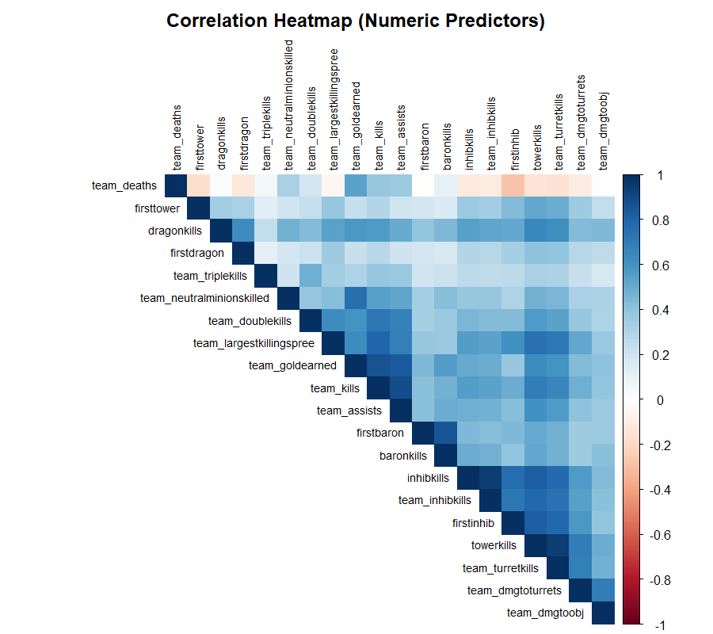
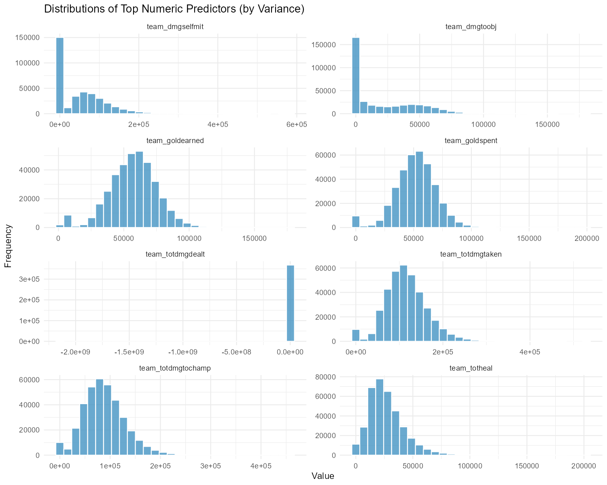

# League of Classifications

**Can you predict who wins a ranked League of Legends match from in-game stats, and which stats matter most?** A machine learning classification project in R / tidymodels, comparing four models on ~180,000 ranked matches (two teams each, ~360,000 team-level rows).

PSTAT 131/231 (Statistical Machine Learning) final project, UC Santa Barbara.



## What's interesting

- **Building one table from six.** The Kaggle data is split across six CSVs at different levels (player, team, match) with no shared key. The pipeline stacks the two stats files, joins them to participants, derives each player's team (players 1 to 5 are blue side, 6 to 10 red), checks that every team has exactly five players, aggregates to one row per team per match, then joins team objectives and match metadata.
- **Four models, one recipe.** Logistic regression (baseline), elastic net (`glmnet`), random forest (`ranger`, 500 trees) and XGBoost all share a preprocessing recipe: impute, dummy-encode, drop zero-variance and highly correlated (|r| > 0.90) predictors, then normalize. Each is tuned with `tune_grid()` over 10-fold stratified cross-validation and compared on ROC AUC.
- **Leakage handled on purpose.** Any column besides the target whose name contains win, loss, result, victory or defeat is dropped automatically. Remakes (under 5 minutes), 60-minute-plus outliers and duplicates are removed first.
- **Interpretation, not just accuracy.** The report covers variable importance for the best model, and odds ratios when a logistic model wins. Gold, objectives (towers, dragons, Baron) and combat stats rank highest.

## Exploratory analysis

| Class balance | Correlations |
|---|---|
|  |  |



## Results

<!-- TODO(Hratch): after knitting, add the CV comparison table and the test-set ROC AUC / accuracy for the best model here. -->

The full write-up, including CV comparison, test-set ROC curve, confusion matrix and variable importance, is in [`report/final_report.Rmd`](report/final_report.Rmd). Knit it to reproduce every number and figure.

**Limitation worth knowing:** the dataset only has end-of-game totals, so features like towers destroyed describe the whole game rather than an early snapshot. The models answer "which in-game factors separate winners from losers", not "who will win from minute 10".

## Tech Stack

R, tidymodels (recipes, parsnip, tune, yardstick), glmnet, ranger, xgboost, vip, ggplot2, corrplot, renv

## Reproduce

```r
# 1. Open final_project.Rproj in RStudio
renv::restore()                                  # or install the packages in renv.lock
rmarkdown::render("report/final_report.Rmd")    # writes report/final_report.html
```

The raw CSVs in `data/` are stored with **Git LFS**, so run `git lfs pull` after cloning, or download them from Kaggle (below). The report caches the merged table to `data/prepared_data.csv`. `SAMPLE_N` at the top of the report controls the sample size: it is set to 5,000 rows for a quick run; set it to `NULL` to use every row.

## Project Structure

```
report/final_report.Rmd   # the full, self-contained analysis
R/                        # step-by-step scripts: prepare, clean, EDA, model, evaluate
config.R                  # shared settings for the R/ scripts
output/                   # EDA plots and summary stats
data/                     # Kaggle CSVs (Git LFS)
```

## Data

Paololol (2018). *League of Legends Ranked Matches*. Kaggle. https://www.kaggle.com/datasets/paololol/league-of-legends-ranked-matches
